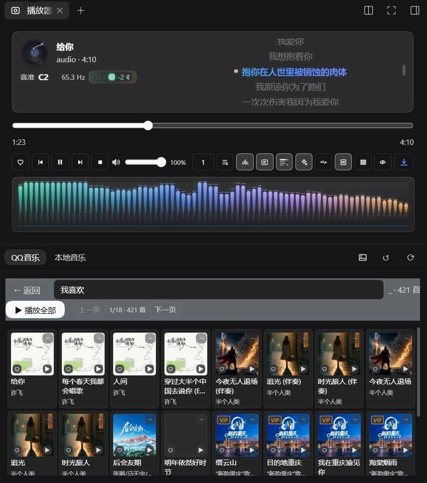
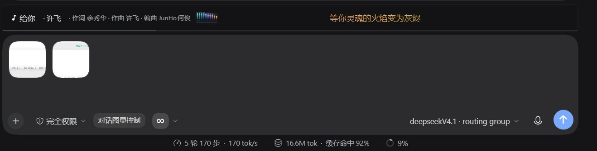
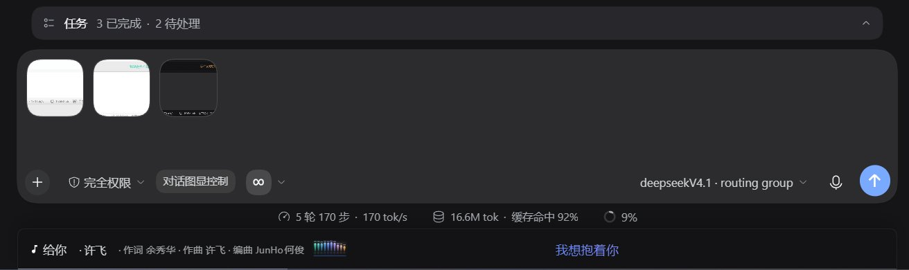

# 侧边栏多媒体播放器（dsh-sidebar-media-player）

侧边栏统一音视频播放器，作为 `dsh-better-sidebar` 的配套插件：一个 viewer 同时接管视频与音频预览，并提供独立的**播放器面板**（QQ 音乐在线曲库 + 本地音乐库）、一条可三态摆放的**胶囊播放条**，以及实时频谱 / 音准 / 歌词 / 字幕等播放态增强。

**适配 DSH 内核 0.2.2-rc.1；当前版本 0.2.17。**

> 0.2.6 起，此前记录的已知缺陷（进度条拖不动、切歌/收藏/倍速失效、歌词动效不生效、胶囊位置切换后消失等）已逐项修复；发布前对默认值、源码改动与打包清单做过机器断言核验（校验脚本随源码改动在开发环境执行，未纳入发布包）。仍建议先小范围试用再依赖。

- 版本：0.2.17
- 依赖：`dsh-better-sidebar`（提供 `ctx.betterSidebar` 文件查看器注册服务；缺失时插件自动降级，不影响 DSH 启动）

## 免责申明（请先读）

本插件是**第三方爱好者工具，不是 QQ 音乐官方产品，与腾讯 / QQ 音乐没有任何隶属或合作关系**。

- **目的**：只为了让 QQ 音乐的忠实用户，能在自己的 DSH 侧边栏里更方便地播放**自己账号的 QQ 音乐歌单**。
- **范围**：仅支持「播放 QQ 音乐列表」这一件事；**不支持、也不参与任何官方活动**——不做签到、不做任务、不领券、不刷播放量、不破解会员权益、不下载版权内容。
- **内容归属**：所有音乐、账号与版权均归腾讯 / QQ 音乐所有。本插件不存储、不分发任何音频文件，播放走的是用户自己已登录的账号。
- **请移步官方**：需要完整功能、会员权益或官方活动，请使用 QQ 音乐官方客户端 / 官网（y.qq.com）。
- **侵权即删**：若权利方认为本项目构成侵权，请告知，**收到通知后立即删除仓库（连同 npm 包与 Release）**，不做申辩或拖延。

## 来源与致谢（哪些是照抄的、哪些是自己做的）

为避免误会，把来源讲清楚：

**照抄第三方原作者的部分（上游 MIT）**

- **胶囊播放条的 UI 设计与落位方式**：输入框上方 / 页面底部的落位行为、两层容器结构、尺寸与样式数值、悬停收起机制 —— 逐字照抄 `dsh-music-player v1.0.4`（MIT，作者 kendu76），源码内已注明参照位置。
- **QQ 音乐接口层**：`lib/qq.js` 的接口签名、请求与响应解析，以及 `lib/qrc.js` 的扫码登录渲染 —— 来自上游实现（MIT），版权归原作者。

**本人设计并实现的部分**

- 把播放器**整个搬进侧边栏**：`ctx.betterSidebar` viewer 注册、侧边栏播放器面板、页签行（QQ音乐 / 本地音乐 / 隐藏列表 / ⟲ / ⟳）。
- **胶囊上的按钮**：收藏、上一首、播放暂停、下一首、停止、音量、播放列表，以及与侧边栏按钮一一对应的同一控制源。
- **界面改造**：控件行 18 枚同风格按钮、胶囊三态位置（上 / 下 / 隐藏）、精简播放条、歌词区与频谱 / 音准区、列表 6–10 列、唱片占位图、翻页与「播放全部」同行。
- **主要功能**：本地音乐库与整文件 Blob seek、收藏与 QQ 音乐「我喜欢」同源、循环三态对手动切歌生效、歌词 5 档动效、字幕、默认值与一次性迁移。

## 功能

### 1. 侧边栏统一音视频播放器

- **视频**：mp4 / webm / mov / m4v / ogv；**音频**：mp3 / wav / flac / ogg / opus / m4a / aac。
- **字幕**：自动加载同目录同名 `.srt / .vtt / .ass`（宿主统一转 VTT），自绘字幕层，支持开关 / 字号 4 档 / 位置 3 档，设置本地记忆。
- **拖动进度条**：自建 Range(206) 流式路由；桌面端 `content-length` 被剥离时用整文件 Blob 兜底，保证时长与 seek 可用。
- **不支持的编码**（wma / ape / ncm / qmc 等）给出中文提示，而不是静默无声。

### 2. 侧边栏播放器面板（两个页签：QQ音乐 / 本地音乐）

- **顶部播放器区**：唱盘 + 歌名、歌词区（两句 / 歌词板）、实时频谱（柱状 / 波形）、音准读数（Hz + 音名 + 音分刻度尺）、进度条、控件行。
- **页签行**：`QQ音乐` / `本地音乐` 两个页签（点页签自动展开列表）+ `隐藏列表`（只留上方播放器）+ `⟲` 刷新 QQ 数据（不重载页面、不中断播放）+ `⟳` 检查更新。
- **控件行（18 枚候选同风格按钮，同屏最多 17 枚——字幕钮只在视频出现、歌词模式钮只在音频出现；单行不折行）**：收藏、上一首、播放/暂停、下一首、停止、音量、倍速 0.5–2、循环（顺序 → 单曲 → 随机）、频谱开关、频谱样式（柱状/波形）、字幕、歌词开关、歌词模式（两句/歌词板）、歌词动效（无/上滑/模糊/卡拉OK/炫彩 5 档）、胶囊位置（上/下/隐藏）、列表列数（6–10）、精简播放条、下载原文件。
- 原「系统配置」独立页已并入控件行，不再有单独的设置页。

### 3. 本地音乐库

- 递归扫描音乐库目录（扫描深度固定 8 层，当前无 UI 可调），支持「重新扫描」「选目录」、点行播放；列表最多显示前 2 万条。
- 音频项走**整文件 Blob** 读取 → 时长与 seek 完整可靠（这是本地曲能拖动快进的关键）；**视频**与 >250MB 大文件仍走 `/media` 直链，避免占内存。
- 无封面的歌单/条目统一用**唱片图标**占位；列表行内也带一枚小唱片标记。

### 4. QQ 音乐在线曲库

- 搜索、榜单、歌单（含「我喜欢」）、新歌速递；卡片封面 1:1 `contain` 自适应、VIP 左上角标、播放键右下小圆。
- **收藏与 QQ 音乐「我喜欢」同源**：胶囊 ♥、面板 ♥、卡片 ♥ 三处读写同一个集合（宿主 `GET /qq/liked` 读、`POST /qq/fav` 写），不是插件自建的本地标记。
- 歌词（含逐字歌词回落）、MV 同源反代（透传 Range/206）。
- 卡片列数 6–10 可调；「翻页」与「播放全部」同一行，列表区不被页脚占用。

### 5. 胶囊播放条

- **三种位置**：输入框上方（默认）/ 页面底部 / 隐藏。选「隐藏」则完全不渲染胶囊条（侧边栏面板顶部的播放器不受影响）。
- **精简播放条**：可切换成只留音符 + 歌名的一行（与「隐藏」是两件事）。
- 条上按钮与面板控件**一一对应、同一控制源**（`SMP_STORE`）：收藏、上一首、播放/暂停、下一首、停止、音量、播放列表。
- 音量竖条可上下拖动；歌词单行显示并跟随 5 档动效；点歌名可展开/收起。

## 默认值（0.2.6 起定稿）

| 项 | 默认值 |
|---|---|
| 胶囊位置 | 输入框上方（dock） |
| QQ 卡片列数 | 10 列 |
| 歌词动效 | 炫彩（rainbow） |
| 循环模式 | 顺序播放 |
| 频谱 | 打开，柱状 |
| 歌词模式 | 两句（duo） |

升级到 0.2.6 时会做一次**一次性迁移**（localStorage 标记 `smp.appearanceRev2`），把上述外观项拉到默认值；之后手动改过的设置完全保留，不再被覆盖。

## 安装

**官方安装方式**：DSH 设置页的「插件市场」直接安装，或由宿主通过 `plugin_manager` 的 `install_bundle` 安装（target 填本插件目录，或填 npm 包名 `dsh-sidebar-media-player`）。安装与 bundle 选择一律走这条官方通道，不要用 shell / CLI 复刻安装步骤。

> **桌面端绕行说明（宿主限制下的 workaround）**：桌面端 `desktop` profile 由 Electron 独占管理，CLI 通道对 `desktop` profile 不可用（`dsh plugin --profile desktop add` 会被 CLI 直接拒绝）。因此在桌面端需要「真实副本 + 只加 bundles」的手动挂载：
>
> 1. 备份 `~/.dsh/profiles/desktop/package.json` 与 `cordis.patch.yml`；
> 2. 把插件真实副本放到 `local-plugins/` 下并加入 profile 的 `dependencies` 与 `dsh.profile.bundles`；
> 3. **彻底退出 DSH 客户端再启动**（宿主是 Node 进程，没有热重载）。

## 生效方式

| 改了什么 | 怎么生效 |
|---|---|
| `lib/client.js`（客户端 bundle） | `Ctrl+Shift+R` 硬刷新；没变化就彻底退出 DSH 再启动 |
| `lib/index.js`（宿主端）/ `package.json` / `cordis.patch.yml` | 彻底退出 DSH 客户端再启动 |
| 面板底部构建戳（`构建 YYYY-MM-DD HH:mm`） | 用来判断是否加载到新 bundle |

## 截图







## 已知限制

- **QQ 登录态的存放位置**：当前版本仍把 QQ 音乐登录 Cookie 写在本机 `~/.dsh/sidebar-media-player-qq-cookie.json`（明文、仅本机可见），尚未迁到 DSH 官方的凭据服务（`ctx.credentials`）。后续版本会迁移；迁移前请自行注意该文件的存在与清理。

- QQ 音乐的付费 / VIP 曲目受登录账号权限限制；无版权或下架曲目无法播放。
- 浏览器原生不支持的编码（wma / ape / ncm / qmc）只能提示，不能解码。
- 无歌词 / 无时间轴的曲目显示「无歌词」；逐字歌词缺失时回落到整行歌词。
- 本地音乐的 seek 依赖整文件 Blob，超大文件（>250MB）走直链时依赖浏览器 Range 缓冲进度。

## 文件结构

```
dsh-sidebar-media-player/
├── package.json        # name/version/type/main/exports/dsh.bundle/dsh.client
├── cordis.patch.yml    # insert 1 条 entry（id=name=dsh-sidebar-media-player）
├── lib/index.js        # host：Range(206) 媒体路由 / 曲库扫描 / 歌词字幕 / QQ 音乐代理
├── lib/client.js       # client：__ModuleLoader__ bundle（viewer + 面板 + 胶囊条）
├── lib/qq.js           # QQ 音乐接口签名与解析
├── lib/qrc.js          # 二维码渲染（QQ 登录扫码）
├── docs/screenshots/   # 真实界面截图
├── screenshots.json    # 插件市场配图清单（纯数组、相对路径）
├── locale/{zh,en}.json # 市场标题与描述
├── icon.svg
├── CHANGELOG.md
├── README.md
└── LICENSE
```

## 更新日志

见 [CHANGELOG.md](CHANGELOG.md)。

---

# dsh-sidebar-media-player (Sidebar Media Player)

A unified audio + video player for `dsh-better-sidebar`. One viewer takes over audio/video preview, and the plugin adds its own **player panel** (QQ Music online library + local library) and a **capsule bar** that can sit in three places, plus live spectrum, pitch readout, lyrics and subtitles.

**Adapts the DSH kernel 0.2.2-rc.1; current version 0.2.17.**

> Since 0.2.6, the previously documented defects (undroppable scrubber, dead next/favourite/rate controls, lyrics effects not applying, capsule disappearing after changing position) have been fixed one by one. Defaults, source changes and the packed file list were checked with machine assertions during development; those check scripts live in the development environment and are not shipped in this package. Trying it on a small scale first is still recommended.

- Version: 0.2.17
- Requires: `dsh-better-sidebar` (provides the `ctx.betterSidebar` viewer registration service; when absent the plugin degrades gracefully and never blocks DSH startup)

## Disclaimer (please read first)

This plugin is a **third-party hobby tool. It is not an official QQ Music product and has no affiliation or partnership with Tencent / QQ Music.**

- **Purpose**: only to make it easier for loyal QQ Music users to play **their own QQ Music playlists** inside their own DSH sidebar.
- **Scope**: playing QQ Music playlists and nothing else. It does **not** support or take part in any official campaign — no check-ins, no quests, no coupons, no play-count inflation, no membership bypass, no downloading of copyrighted content.
- **Ownership**: all music, accounts and copyrights belong to Tencent / QQ Music. This plugin stores and distributes no audio; playback uses the account the user has already signed in with.
- **Use the official app**: for full features, membership benefits or official campaigns, please use the official QQ Music client or site (y.qq.com).
- **Takedown on request**: if a rights holder considers this project infringing, tell us and the **repository will be deleted immediately, together with the npm package and any Release**.

## Credits & provenance (what is copied, what is original)

**Copied from third-party upstream (MIT)**

- **The capsule bar UI design and placement**: the dock-above-input / bottom-of-window behaviour, the two-layer container structure, the size and style values and the hover-collapse mechanism are copied verbatim from `dsh-music-player v1.0.4` (MIT, by kendu76); the source marks every reference location.
- **The QQ Music API layer**: request signing, calls and response parsing in `lib/qq.js`, plus the QR login renderer `lib/qrc.js`, come from that upstream implementation (MIT). Copyright remains with the original author.

**Designed and implemented here**

- Moving the whole player **into the sidebar**: the `ctx.betterSidebar` viewer registration, the player panel, and the tab row (QQ音乐 / 本地音乐 / hide list / ⟲ / ⟳).
- **The capsule buttons**: favourite, previous, play/pause, next, stop, volume and playlist, all driven by the same store as the sidebar buttons.
- **The UI rework**: the 18-button control row in one style, the three-state capsule position (top / bottom / hidden), the compact bar, the lyric + spectrum + pitch area, 6–10 grid columns, vinyl artwork fallback, pager next to "play all".
- **The main features**: local library with whole-file Blob seeking, favourites shared with QQ Music's "I like", loop modes that also apply to manual next, five lyric effects, subtitles, defaults plus the one-time migration.

## Features

### 1. Unified sidebar audio/video viewer

- **Video**: mp4 / webm / mov / m4v / ogv. **Audio**: mp3 / wav / flac / ogg / opus / m4a / aac.
- **Subtitles**: same-name `.srt / .vtt / .ass` auto-loaded (converted to VTT host-side), custom subtitle layer with on/off, 4 font sizes and 3 positions, remembered locally.
- **Draggable scrubber**: self-hosted Range(206) streaming route; when the desktop shell strips `content-length`, a whole-file Blob rescue keeps duration and seeking working.
- **Unsupported codecs** (wma / ape / ncm / qmc …) produce an explicit message instead of silence.

### 2. Player panel (two tabs: QQ音乐 / 本地音乐)

- **Top player area**: turntable + title, lyrics (two-line or lyric board), live spectrum (bars or wave), pitch readout (Hz + note name + cents ruler), scrubber, control row.
- **Tab row**: `QQ音乐` / `本地音乐` tabs (clicking a tab auto-expands the list) + `Hide list` (keeps only the top player) + `⟲` refresh QQ data (no page reload, no playback interruption) + `⟳` check for updates.
- **Control row (18 candidate buttons in one style, at most 17 on screen — the subtitle button only appears for video and the lyric-mode button only for audio; one line, no wrapping)**: favourite, previous, play/pause, next, stop, volume, playback rate 0.5–2, loop (order → single → shuffle), spectrum on/off, spectrum style (bars/wave), subtitles, lyrics on/off, lyric mode (two-line/board), lyric effect (none/slide/blur/karaoke/rainbow), capsule position (top/bottom/hidden), grid columns (6–10), compact bar, download original file.
- The former standalone "settings" tab has been folded into this control row.

### 3. Local music library

- Recursively scans the music directory (depth fixed at 8 levels, not configurable in the UI), with rescan, pick-directory and per-row play; the list shows at most 20,000 entries.
- Audio items are read as a **whole-file Blob** so duration and seeking are complete and reliable; **video** and files over 250MB still stream from `/media` to keep memory flat.
- Playlists/items without artwork fall back to a **vinyl record icon** (also shown inline in each list row).

### 4. QQ Music online library

- Search, charts, playlists (including "I like"), new songs; 1:1 `contain` artwork, VIP corner badge, small play button.
- **Favourites are shared with QQ Music's own "I like"**: capsule heart, panel heart and card heart all read and write the same remote collection (host `GET /qq/liked` / `POST /qq/fav`), not a local flag.
- Lyrics (with word-by-word fallback), MV proxied same-origin with Range/206 passthrough.
- Grid columns adjustable 6–10; pager sits on the same line as "Play all" so the list never loses a row to the footer.

### 5. Capsule bar

- **Three positions**: above the input box (default) / bottom of the window / hidden. Choosing "hidden" stops rendering the capsule entirely (the panel's top player is unaffected).
- **Compact mode** shrinks it to one line with just a note glyph and the title.
- Every capsule button **maps one-to-one onto a panel control** through the same store (`SMP_STORE`): favourite, previous, play/pause, next, stop, volume, playlist.
- Vertical volume slider is draggable; the single-line lyric follows the same 5 lyric effects.

## Defaults (as of 0.2.6)

| Item | Default |
|---|---|
| Capsule position | Above the input box (dock) |
| QQ grid columns | 10 |
| Lyric effect | Rainbow |
| Loop mode | Sequential |
| Spectrum | On, bars |
| Lyric mode | Two lines (duo) |

Upgrading to 0.2.6 runs a **one-time migration** (localStorage marker `smp.appearanceRev2`) that pulls these appearance settings back to defaults; anything you change afterwards is preserved.

## Install

**Official way**: install it from the plugin market in the DSH settings page, or have the host install it through `plugin_manager`'s `install_bundle` (target = this plugin directory, or the npm package name `dsh-sidebar-media-player`). Package installation and bundle selection always go through this official channel — do not reproduce those steps with shell commands.

> **Desktop workaround (Electron-managed desktop profile)**: on desktop the `desktop` profile is managed exclusively by Electron and the CLI channel is not available for it (`dsh plugin --profile desktop add` is rejected by the CLI). So on desktop, mount it manually with a real copy plus bundles only: back up `~/.dsh/profiles/desktop/package.json` and `cordis.patch.yml`, place a real copy under `local-plugins/`, wire it into `dependencies` and `dsh.profile.bundles`, then **fully quit and relaunch DSH** (the host is a Node process with no hot reload).

## How changes take effect

| What changed | How to apply |
|---|---|
| `lib/client.js` (client bundle) | `Ctrl+Shift+R` hard refresh; if nothing changes, fully quit and relaunch DSH |
| `lib/index.js` (host) / `package.json` / `cordis.patch.yml` | Fully quit and relaunch DSH |
| Build stamp at the panel bottom (`构建 YYYY-MM-DD HH:mm`) | Tells you whether the new bundle is loaded |

## Screenshots


## Known limitations

- **Where the QQ login state lives**: this version still writes the QQ Music login cookie to a plaintext file at `~/.dsh/sidebar-media-player-qq-cookie.json` (local machine only) instead of the official DSH credential service (`ctx.credentials`). A later version will migrate it; until then be aware of that file and clean it up yourself.

- Paid/VIP QQ Music tracks depend on the signed-in account; unavailable or delisted tracks cannot be played.
- Codecs the browser cannot decode (wma / ape / ncm / qmc) can only be reported.
- Tracks without lyrics or timestamps show "no lyrics"; word-by-word lyrics fall back to line lyrics.
- Local seeking relies on a whole-file Blob; for files over 250MB streamed directly, the browser's Range buffering applies.

## Layout

```
dsh-sidebar-media-player/
├── package.json        # name/version/type/main/exports/dsh.bundle/dsh.client
├── cordis.patch.yml    # one insert entry (id=name=dsh-sidebar-media-player)
├── lib/index.js        # host: Range(206) media route / library scan / lyric+subtitle / QQ proxy
├── lib/client.js       # client: __ModuleLoader__ bundle (viewer + panel + capsule bar)
├── lib/qq.js           # QQ Music signing and parsing
├── lib/qrc.js          # QR code rendering (QQ login scan)
├── docs/screenshots/   # real UI screenshots
├── screenshots.json    # marketplace screenshot list (plain array, relative paths)
├── locale/{zh,en}.json # marketplace title and description
├── icon.svg
├── CHANGELOG.md
├── README.md
└── LICENSE
```

## Changelog

See [CHANGELOG.md](CHANGELOG.md).
