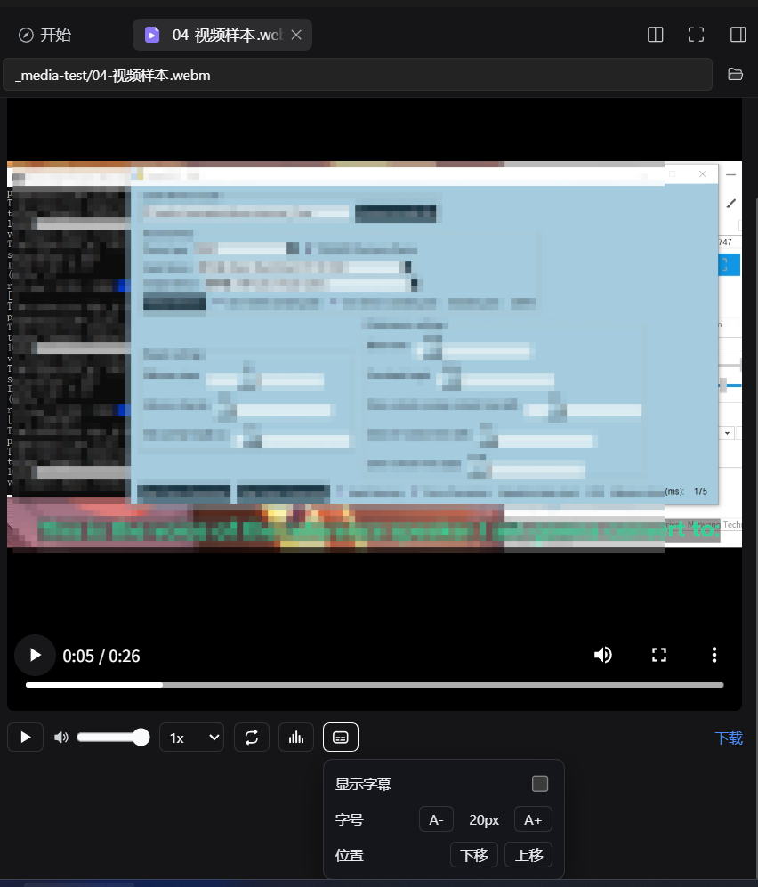
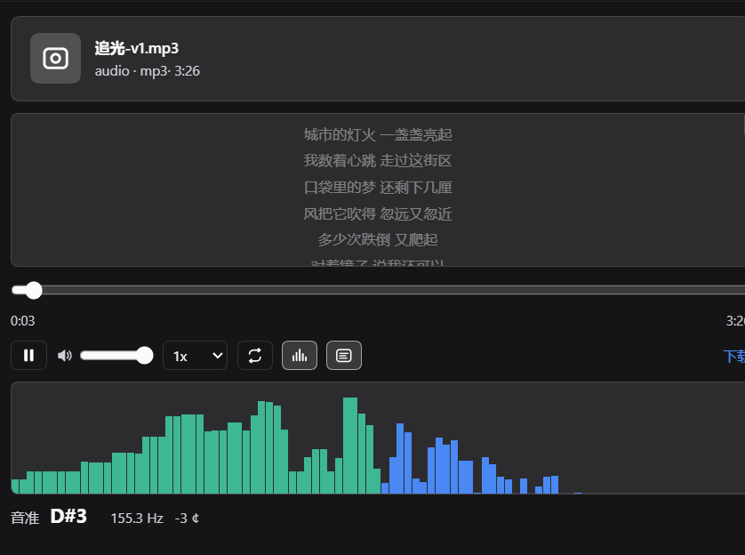

# 侧边栏多媒体播放器（dsh-media-player）

侧边栏统一音视频播放器，作为 `dsh-better-sidebar` 的配套插件，接管侧边栏里音视频文件的预览。一个 viewer 同时覆盖视频与音频扩展名，解决过去做不好的三件事：**能拖的进度条**（HTTP Range 206 流式）、**实时频谱**、**音准读数**；并新增**视频字幕**（同名 `.srt/.vtt/.ass` 自动加载）与**音频歌词**（同名 `.lrc` 滚动高亮）。

**适配 DSH 内核 0.2.2-rc.1。**

- 版本：0.1.1（首个正式发布版本）
- 依赖：`dsh-better-sidebar`（提供 `ctx.betterSidebar` 文件查看器注册服务）

## 功能

- **侧边栏统一音视频播放器**（接管 dsh-better-sidebar 的文件预览）：一个组件按扩展名分流音频与视频。
- **视频**：mp4 / webm / mov / m4v / ogv；**音频**：mp3 / wav / flac / ogg / opus / m4a / aac。
- **拖动进度条（HTTP Range 206 流式）**：自建 Range 路由，浏览器拿到 206 才解锁 seek；含 **Blob 救援**，修复「桌面端 `content-length` 被剥离导致时长未知、进度条不可拖」的问题（音频与视频统一生效，>300MB 也不整文件入内存）。
- **实时频谱柱 + 音准（Hz + 音名）**：`AnalyserNode` 对数分桶柱状图；归一化自相关（ACF）+ 抛物线插值给出 Hz 与音名。
- **视频字幕**：自动加载同目录同名 `.srt / .vtt / .ass`（服务端统一转 VTT），自绘字幕层，支持开关 / 字号 4 档 / 位置 3 档（设置本地记忆）。
- **音频歌词**：自动加载同目录同名 `.lrc`（含内嵌歌词），滚动高亮，支持开关。
- **修复图标尺寸 bug**：图标函数曾被当组件调用，导致 SVG 撑到 300×150 并遮挡进度条，本版修复。

## 截图





## 安装

本插件是 `dsh-better-sidebar` 的配套插件，安装命令：

```bash
dsh plugin add dsh-media-player
```

> 桌面端 `desktop` profile 由 Electron 独占管理（`dsh plugin --profile desktop add` 会被 CLI 直接拒绝），需走「真实副本 + 只加 bundles」的方式手动挂载：
>
> 1. 备份 `~/.dsh/profiles/desktop/package.json` 与 `cordis.patch.yml`；
> 2. 把 `local-plugins/dsh-media-player` 复制成**真实副本**到 `~/.dsh/profiles/desktop/node_modules/dsh-media-player`（**不要**用 `link:`/`file:` 依赖，也不要直接改 pnpm 装出来的目录）；
> 3. 在 profile `package.json` 的 `dsh.profile.bundles` 数组里追加 `"dsh-media-player"`；
> 4. **彻底退出 DSH 客户端再启动**（宿主是 Node 进程，无热重载）；
> 5. 在侧边栏打开任意 `.mp3` / `.mp4` 验证。

## 技术要点

- **可拖动 seek**：宿主媒体路由回 200 且无 `Accept-Ranges` 时浏览器不给拖动条；本插件自建 Range 路由（`bytes=a-b` / `bytes=a-` / `bytes=-N` 三种形态 + HEAD 探测），206 到位即解锁 seek。视频用原生控件，音频用自建 `input[type=range]`（`currentTime` 节流写入，时长与 Web Audio 解码解耦）。
- **频谱**：`createMediaElementSource → AnalyserNode(fftSize 2048) → destination`，`requestAnimationFrame` 每帧 `getByteFrequencyData`，按 40 Hz–16 kHz 对数分桶，canvas 按 `devicePixelRatio` 缩放。
- **音准**：`getFloatTimeDomainData` → 归一化 ACF + 抛物线插值；取第一个达到全局峰 90% 的「先升后降」局部峰，避免八度错位。
- **安全围栏**：Host 信任围栏（loopback / 可信 Host）+ 路径必须落在会话 cwd 内 + 音视频扩展名白名单，本路由不能当通用下载器用。

## 已知限制

- **编码靠浏览器**：`mkv/avi/wmv/flv/ape/wma/amr` 等通常放不出来（无内置解码器），会提示并给下载链接。
- **没有预解码波形**：频谱是实时分析，不是预解码波形。
- **音准是估算**：单声道混音 + ACF，复音（和弦、多人说话）只给出最突出的基频；噪声/打击乐读数会跳动，属正常。
- **视频不带自建进度条**：视频用原生控件（自带拖动、全屏、画中画）；音频才用自建整轨 scrubber。

## 文件结构

```
dsh-media-player/
├── package.json        # name/version/type/main/exports/dsh.bundle/dsh.client
├── cordis.patch.yml    # insert 1 条 entry（id=name=dsh-media-player）
├── lib/index.js        # host：Range(206) 媒体路由 + 安全围栏
├── lib/client.js       # client：__ModuleLoader__ bundle + viewer（音视频统一）
├── docs/screenshots/   # 两张真实界面截图
├── screenshots.json    # 插件市场配图清单（纯数组）
├── CHANGELOG.md
├── README.md
└── LICENSE
```

## 更新日志

见 [CHANGELOG.md](CHANGELOG.md)。

---

# dsh-media-player (Sidebar Media Player)

A unified audio + video player for `dsh-better-sidebar`: one sidebar file viewer that takes over previewing audio/video files. It fixes the three things that used to be broken — **a draggable progress bar** (streamed over an HTTP Range 206 route), **a live spectrum**, and **a pitch readout** — and adds **video subtitles** (same-name `.srt/.vtt/.ass` auto-loaded) and **audio lyrics** (same-name `.lrc`, scroll-highlighted).

**Adapts the DSH kernel 0.2.2-rc.1.**

- Version: 0.1.1 (first public release)
- Requires: `dsh-better-sidebar` (provides the `ctx.betterSidebar` file-viewer registration service)

## Features

- **Unified sidebar audio/video player** (takes over dsh-better-sidebar's file preview): one component dispatches by extension.
- **Video**: mp4 / webm / mov / m4v / ogv; **Audio**: mp3 / wav / flac / ogg / opus / m4a / aac.
- **Draggable progress bar (HTTP Range 206 streaming)**: a self-hosted Range route so the browser receives 206 and unlocks seeking; includes a **Blob rescue** that fixes "on desktop the stripped `content-length` leaves the duration unknown and the scrubber un-draggable" (applies to audio and video alike, and a >300MB file is never loaded fully into memory).
- **Live spectrum bars + pitch (Hz + note name)**: `AnalyserNode` log-binned bars; normalized autocorrelation (ACF) + parabolic interpolation yields Hz and note name.
- **Video subtitles**: auto-loads same-name `.srt / .vtt / .ass` (server converts to VTT), custom subtitle layer, toggle / 4 font sizes / 3 positions (prefs remembered locally).
- **Audio lyrics**: auto-loads same-name `.lrc` (including embedded lyrics), scroll-highlighted, toggleable.
- **Icon size bug fix**: the icon function was mistakenly invoked as a component, stretching the SVG to 300×150 and covering the progress bar — fixed in this release.

## Screenshots


## Install

This plugin is a companion to `dsh-better-sidebar`:

```bash
dsh plugin add dsh-media-player
```

> On desktop, the `desktop` profile is managed exclusively by Electron (`dsh plugin --profile desktop add` is rejected by the CLI), so mount it manually with a real copy + bundles-only:
>
> 1. Back up `~/.dsh/profiles/desktop/package.json` and `cordis.patch.yml`;
> 2. Copy `local-plugins/dsh-media-player` into `~/.dsh/profiles/desktop/node_modules/dsh-media-player` as a **real copy** (do **not** use `link:`/`file:` deps, and do not edit the pnpm-installed directory);
> 3. Append `"dsh-media-player"` to the profile `package.json`'s `dsh.profile.bundles` array;
> 4. **Fully quit and relaunch the DSH client** (the host is a Node process, no hot reload);
> 5. Open any `.mp3` / `.mp4` in the sidebar to verify.

## Changelog

See [CHANGELOG.md](CHANGELOG.md).

## License

MIT
